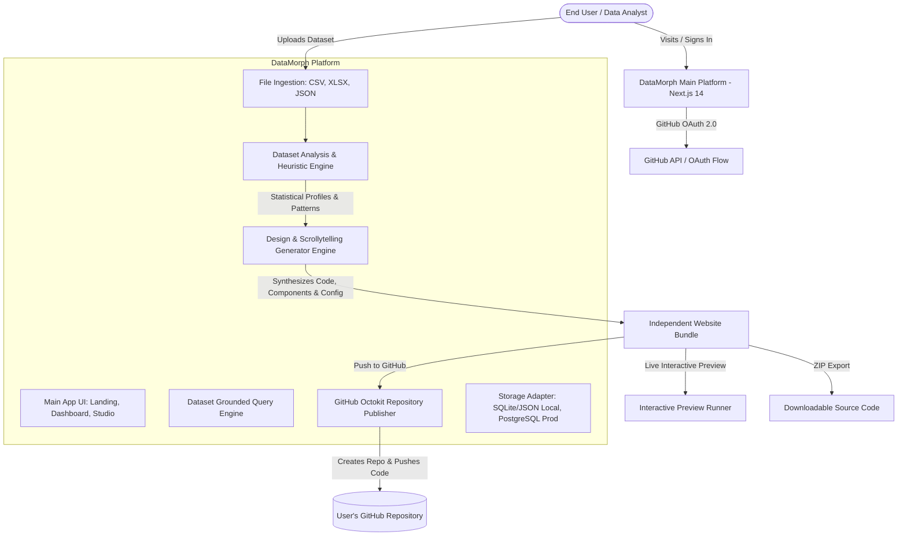

# Architecture Document: DataMorph AI (AI-Powered Dataset-to-Interactive-Website Generator)

## 1. Executive Overview
DataMorph AI is an enterprise-grade, full-stack platform that transforms structured datasets (CSV, XLSX, JSON) into publication-ready, interactive scrollytelling websites. Inspired by data journalism leaders such as *The Pudding* and *The New York Times*, the generated websites feature data-first hero typography, scroll-driven pinned chart animations, statistical summaries, bento-grid deep dives, an interactive data query engine, and an autonomous, dataset-grounded AI chatbot.

Crucially, generated websites are **independent, full-fledged Next.js projects**. Users can preview them live in the browser, download them as self-contained ZIP archives, or push them directly to their personal GitHub account as a brand new repository using secure GitHub OAuth.

---

## 2. High-Level System Architecture



---

## 3. Technology Stack Selection

### 3.1 Main Platform
- **Framework**: Next.js 14 (App Router, Server Actions, Route Handlers)
- **Language**: TypeScript (strict mode)
- **Styling**: Tailwind CSS + Custom Design System tokens (typography, grain textures, dark mode palettes)
- **Icons**: Lucide React
- **Motion & Scrollytelling**: Framer Motion & CSS scroll-driven animations
- **Visualizations**: Recharts (responsive, customizable SVG charts) + Canvas utilities
- **File Parsing**: PapaParse (CSV streaming), XLSX (SheetJS for Excel workbooks), JSON streaming
- **Auth & Session**: GitHub OAuth 2.0 with cryptographically signed HTTP-only cookies (`iron-session` pattern)
- **GitHub Integration**: `@octokit/rest` for automated repository creation and code commit trees
- **Database**: Dual-driver abstraction:
  - Local Dev: Zero-config JSON/SQLite document store (`data/db.json` / SQLite) with atomic transactions
  - Production (Render): PostgreSQL compatible driver via `DATABASE_URL`
- **AI Service Layer**: Pluggable LLM interface supporting Gemini API, OpenAI, or local simulated model with strict dataset grounding

### 3.2 Generated Website Architecture
Each generated website is a completely decoupled Next.js application:
```
generated-project/
├── app/
│   ├── layout.tsx
│   ├── page.tsx            # Main scrollytelling data story
│   ├── globals.css         # Dataset-specific theme & custom fonts
│   └── api/
│       ├── chat/route.ts   # Dataset-grounded AI chatbot endpoint
│       └── query/route.ts  # Structured query & aggregation endpoint
├── components/
│   ├── DataHero.tsx        # High-impact animated number & narrative hook
│   ├── Scrollytelling.tsx  # Pinned chart with sticky step-by-step narrative
│   ├── BentoMetrics.tsx    # Asymmetric metric callouts & distributions
│   ├── InteractiveChart.tsx# User-filterable charts with zoom & tooltips
│   ├── DataExplorer.tsx    # Paginated table with search & column filters
│   └── AIChatbot.tsx       # Floating interactive dataset assistant
├── lib/
│   ├── dataset.json        # Bundled sanitized dataset
│   ├── schema.ts           # Type definitions & statistical metadata
│   ├── queryEngine.ts      # Grounded aggregation, filtering, & stats
│   └── aiService.ts        # Modular LLM client with system prompt grounding
├── public/                 # Static assets, favicon, OG cards
├── package.json            # Standalone dependencies
├── tailwind.config.ts      # Tailored dataset color palette
├── tsconfig.json
├── .env.example
├── .gitignore
└── README.md               # Quickstart: npm install -> npm run dev
```

---

## 4. Key Subsystems & Design Choices

### 4.1 Ingestion & Automatic Dataset Analysis
1. **Validation**: Enforce mime-types (`.csv`, `.xlsx`, `.xls`, `.json`), file size bounds (default 15MB for responsive browser analysis), schema consistency.
2. **Type Inference**: Detect numeric, categorical, date/time, text, boolean, coordinates/geography, and currency.
3. **Statistical Profiling**:
   - Numeric: Mean, median, standard deviation, min, max, quartiles, skewness, outlier counts.
   - Categorical: Cardinality, mode, distribution frequencies, top N values.
   - Temporal: Min/max dates, seasonality, intervals, trends over time.
   - Bivariate: Pearson correlation matrix for numerical pairs, cross-tabulations.
4. **Data Quality Score**: Missing value ratios, duplicate records, anomaly flags.

### 4.2 Editorial Scrollytelling Engine
Rather than generic BI dashboards, the engine designs a visual journalistic narrative:
1. **Editorial Angle**: Analyzes the most significant trend, outlier, or distribution to craft a data-first headline (e.g. *"4,812 runs. One season."* or *"73% growth across 5 quarters"*).
2. **Pinned Scrollytelling**:
   - Pinned visualization pane on one side (or background).
   - Scrollable text cards on the other that trigger state transitions in the visualization as user reaches key milestones.
3. **Adaptive Visual Palette**: Automatically assigns an editorial theme based on data domain:
   - *Financial / Tech*: Midnight Onyx, Electric Cyan, Emerald Green.
   - *Health / Social*: Warm Ochre, Terracotta, Off-White, Forest.
   - *E-Commerce / Consumer*: Rich Indigo, Coral Neon, Slate Gray.

### 4.3 Grounded AI Chatbot
- **Zero Hallucination Rule**: The LLM is never given raw data without query execution context.
- **Workflow**:
  1. User asks question: *"What was the highest revenue category in Q3?"*
  2. Query Engine parses question or generates a deterministic query plan.
  3. Query plan executes against in-memory indexed dataset (aggregating sums, averages, counts).
  4. Query result is injected into the LLM context prompt alongside exact computed numbers.
  5. LLM formats a conversational editorial explanation referencing exact verified numbers.

### 4.4 GitHub Publishing Pipeline
1. Authenticate user via GitHub OAuth with `repo` scope.
2. Verify / prompt user for new repository name and visibility (Public / Private).
3. Synthesize the complete project file tree into memory.
4. Using `@octokit/rest`:
   - `octokit.repos.createForAuthenticatedUser({ name, private, auto_init: false })`
   - Upload file tree using GitHub Git Data API (Blobs, Tree, Commit, Ref update) for instantaneous, reliable single-commit publishing.
5. Provide user direct clickable repository link and clone instructions.

---

## 5. Security & Privacy
- **OAuth Protection**: Cryptographic `state` nonce stored in HTTP-only cookie prevents CSRF.
- **Token Security**: GitHub access tokens are encrypted with AES-256 before storage in session or DB, and never sent to client-side code.
- **Isolated User Workspaces**: Datasets and projects are keyed strictly to authenticated user IDs.
- **No Token Leakage**: Standalone generated code explicitly excludes all platform credentials; `.env.example` provides placeholders for the user's independent LLM keys.
- **Sanitized Uploads**: Input sanitization prevents CSV formula injection (`=cmd|' /C...`) and script execution.

---

## 6. Deployment Strategy
- **Platform Host**: Render (Node.js Web Service)
  - Build Command: `npm install && npm run build`
  - Start Command: `npm run start`
- **Database**:
  - Dev: Embedded local store (works out of the box with `npm run dev`)
  - Render Production: Managed PostgreSQL via standard connection string.
